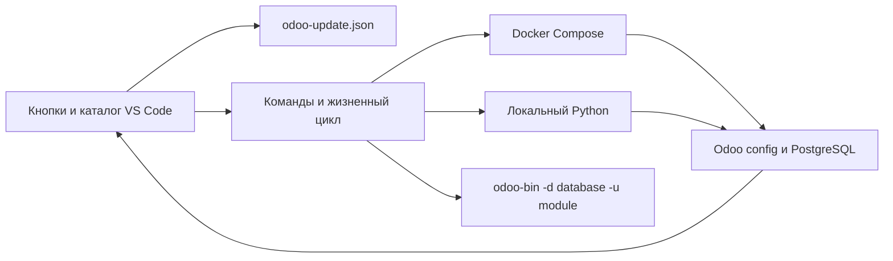

# Odoo Module Updater

Расширение VS Code для разработки на Odoo 17. Выберите окружение, базу и модуль один раз.
Кнопка в строке состояния обновляет выбранный модуль и установленные модули, которые от него зависят.

Поддерживаются Docker Compose и локальный Python с исходниками или установленным пакетом Odoo 17.
Каталоги аддонов читаются через конфигурацию самого Odoo. Папки проекта и названия сервисов задаются пользователем.

## Установка

Скачайте VSIX из Releases и выполните **Extensions: Install from VSIX…** в VS Code.
Затем выполните **Developer: Reload Window** и откройте рабочую папку проекта.
Расширение использует Node.js, встроенный в VS Code. Для работы требуется Python окружения Odoo с его зависимостями.

## Настройка

Команда **Odoo: открыть настройки расширения** создаёт `.vscode/odoo-update.json` в открытой папке.
Есть готовые примеры для [Docker Compose](examples/docker.json), [локального остановленного сервера](examples/local.json),
[службы Windows](examples/windows-service.json) и [systemd](examples/linux-service.json).

```json
{
  "version": 1,
  "profiles": {
    "dev": {
      "label": "Мой Odoo 17",
      "type": "docker",
      "composeFiles": ["docker-compose.yml"],
      "service": "odoo",
      "python": "python3",
      "odooBin": "/usr/bin/odoo",
      "config": "/etc/odoo/odoo.conf"
    }
  }
}
```

Относительные пути на стороне VS Code считаются от папки, содержащей `.vscode`. Доступна переменная `${workspaceFolder}`.
Если открыта вложенная папка, расширение ищет ближайший конфиг выше по дереву. Для multi-root workspace доступен выбор профиля из разных папок.

В Docker `python`, `odooBin`, `config` и `addonsPath` указываются внутри контейнера.
`composeFiles` и `cwd` указываются на машине, где работает extension host VS Code.
`odooBin` должен быть Python-скриптом, который запускается выбранным интерпретатором.
Подключение к PostgreSQL читается из `odoo.conf`. При ограниченном доступе к списку баз задайте `database` в профиле.
Профиль может содержать `addonsPath`, если ваш обычный запуск переопределяет `--addons-path` из конфигурации.

Для локального сервера есть два варианта. Команды `stopCommand` и `startCommand` управляют вашей службой.
Либо `serverAlreadyStopped: true` указывает, что сервер вы остановили вручную. Права для управления службой настраиваются пользователем ОС.
Команды запускаются с массивом аргументов через `spawn`, shell не используется. Для сложного сценария укажите отдельный исполняемый скрипт.

## Работа

1. Командой **Odoo: выбрать окружение** выберите профиль.
2. Кнопкой базы выберите базу Odoo. Имя видно в строке состояния.
3. Кнопкой модуля выберите установленный модуль. Поиск учитывает техническое имя, название и путь.
4. Команда **Odoo: показать план обновления** выводит выбранный модуль и установленные зависимые модули, включая косвенные зависимости.
5. Кнопка **Обновить модуль** запускает штатный `-u`. Лог виден в **Output → Odoo Module Updater**.

Выбор хранится отдельно для рабочей папки, профиля и окружения. Перед запуском установка модуля проверяется заново.
Если модуль деинсталлирован, сохранённый выбор сбрасывается. Повторно выбирать установленный модуль при каждом обновлении не требуется.

В Explorer находится **Odoo Modules**. Команда обновления каталога показывает все найденные модули, включая неустановленные.
Клик выбирает установленный модуль для обновления. У каждого элемента указаны состояние, путь и категория.
Категория `core` определяется по расположению рядом с `base`, `web` или `web_enterprise`. Категория `extra` означает другой каталог.
Это эвристика расположения. Источник истины для пользователя — полный путь к модулю.
При дубликатах имён учитывается первый путь в порядке поиска Odoo.

План строится по текущим manifest и состоянию БД. Окончательный состав и порядок определяет Odoo во время `-u`.
Обновление `base` включает все установленные модули по правилам Odoo.

## Жизненный цикл сервера

Для Docker каталог читается в одноразовом контейнере с настройками сервиса Compose. Контейнер приложения может быть остановлен,
но PostgreSQL должен быть доступен. Сервис приложения, работающий перед обновлением, останавливается и запускается после завершения,
включая завершение с ошибкой. Изначально остановленный сервис остаётся остановленным. Локальный режим выполняет заданные команды службы.
Перезапуск процесса разрывает подключение Python-отладчика. После обновления подключите его снова.

Одна операция блокирует другие обновления этого окружения из расширения. Файл блокировки хранится в global storage VS Code.
Если VS Code аварийно завершился, убедитесь, что процесс обновления и одноразовый контейнер завершены,
и удалите файл, путь к которому указан в ошибке. Расширение не управляет другими запущенными экземплярами Odoo на той же БД.

## Разработка и сборка

Для сборки нужны Node.js 22+ и Python 3.10+. Runtime Python берётся из Odoo и для Odoo 17 зависит от вашей установки.

```sh
npm ci --ignore-scripts
npm test
python test/catalog_test.py
npm run package
python scripts/source_archive.py
```

В `dist` появятся VSIX и ZIP исходников. Сборка использует официальный `@vscode/vsce`, runtime npm-зависимости отсутствуют.
Исходный архив собирается по списку файлов проекта. Личные конфиги, пароли и пути разработчика в архив не включаются.
Чтобы проверить расширение в VS Code, откройте эту папку и запустите Extension Development Host с параметром
`code --extensionDevelopmentPath=.`. Тестовые сценарии реального каталога запускаются командой
`node scripts/smoke.js /path/to/your/workspace`. Эта проверка читает метаданные Odoo.

Для выпуска соберите VSIX и архив, затем создайте GitHub Release и прикрепите оба файла из `dist`.
Репозиторий может быть приватным. Для общей раздачи откройте доступ участникам или передайте им готовый VSIX.

## Устройство



`src/extension.js` отвечает за VS Code API и сохранение выбора. `src/core.js` строит команды и управляет сервером.
`src/catalog.py` получает реальные пути Odoo, читает manifest через `ast.literal_eval` и выполняет SQL-запросы метаданных
в read-only соединении. Обновление выполняет штатная CLI Odoo.

Лицензия MIT. Расширение является независимым инструментом сообщества.

## Версия 0.3: обновление работающего сервера

В профиль добавьте `"updateMode": "rpc"`, `"serverUrl": "http://127.0.0.1:8069"` и `"login": "admin"`.
Полный пример — `examples/local-rpc.json`. Без `updateMode` остаётся прежний CLI-режим.
Поля Python/config остаются нужны для каталога и предварительного плана. Они должны описывать тот же сервер и базу, что serverUrl.
Пароль вводится скрыто в VS Code и сохраняется через SecretStorage, а не в JSON. Команда **Odoo: удалить сохранённый пароль** сбрасывает пароль и сессию.
В этой версии поддерживается обычный вход без интерактивной двухфакторной аутентификации. Удалённые адреса требуют HTTPS; HTTP допускается для localhost.

RPC выполняет штатный `button_immediate_upgrade`, как кнопка обновления в Odoo. Процесс сервера не перезапускается.
Odoo пересобирает реестр: запросы могут задерживаться, ошибка XML может прервать обновление. Это не обещание отсутствия простоя или автоматического отката.
Изменения уже импортированного Python-кода этим способом не загружаются: используйте обычный перезапуск/CLI.
Для CSS/JS, статических XML assets, noupdate-записей и изменённых в интерфейсе представлений результат зависит от механизмов Odoo и кэша браузера.

## Режим вёрстки

1. Выберите RPC-профиль и учебную базу.
2. Откройте XML-файл установленного модуля, перечисленный в `data` его `__manifest__.py`.
3. Выполните **Odoo: включить режим вёрстки**. Модуль определяется по открытому файлу, база выбирается явно.
4. Сохраните изменения. Через 800 мс после последнего сохранения расширение запустит обновление.
5. После сообщения об успехе обновите страницу браузера вручную.

Несколько сохранений до запуска объединяются. Сохранения во время обновления дают не более одного следующего запуска.
Ошибка выключает режим: исправьте XML и включите режим снова. Смена профиля, базы или модуля выключает режим и удаляет очередь.
Команда выключения доступна и во время запроса; уже отправленная операция Odoo продолжает выполняться.
Изменение manifest требует повторного включения режима. Python, JS, SCSS и XML вне `data` не запускают обновление.
Исходники должны быть доступны extension host по тому же реальному пути, который использует Odoo. Для Docker с разными путями открывайте проект через Dev Containers; сопоставление произвольных host/container путей не реализовано.

Если ответ на отправленный запрос потерян (обрыв, таймаут, неверный ответ HTTP), расширение оставляет блокировку с неопределённым результатом.
Оно не повторяет запрос и не переключается на CLI. Проверьте в Odoo и журнале сервера, что операция завершена, затем выполните
**Odoo: снять блокировку неопределённого обновления**. Подтверждение снимает только такую блокировку, а не блокировку активного запроса.
Пароли и cookies не записываются в журнал. В журнале видны цель, план и длительность операции; предварительное чтение каталога в эту длительность не включено.

### Проверки 0.3

`npm test` включает RPC-протокол, раздельные сессии, таймауты, отказ без прав/модуля, очередь сохранений и совместимость CLI.
`python3 -B test/catalog_test.py` проверяет каталог, manifest data и зависимости.
Для интеграционных проверок используйте отдельную учебную базу. Не выдавайте несколько успешных обновлений за доказательство надёжности на всех установках Odoo.
